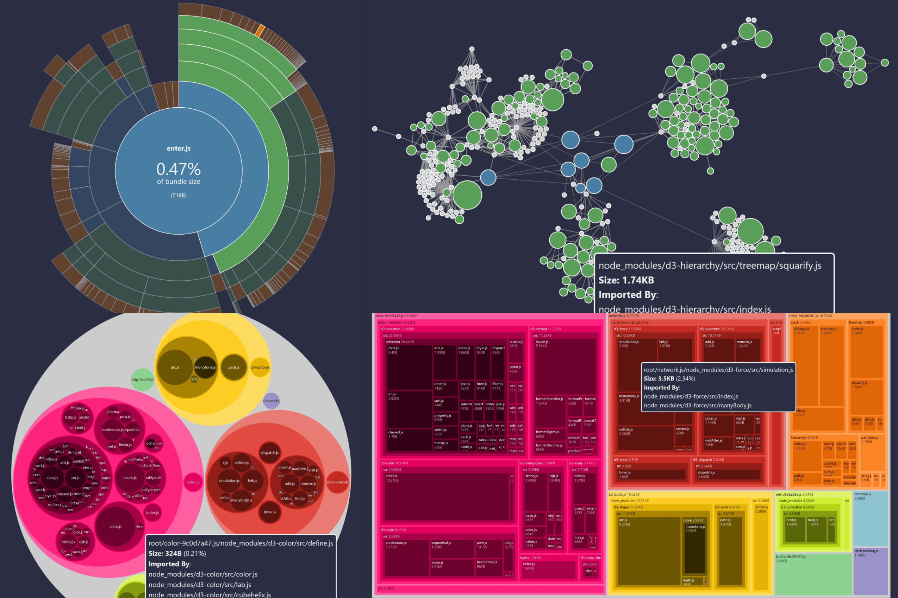

# Rollup Plugin Visualizer

Visualize and analyze your bundle to quickly see which modules are taking up space.

[](https://npmjs.org/package/rollup-plugin-visualizer) [](https://github.com/btd/rollup-plugin-visualizer/actions/workflows/node.js.yml)

## Sharing reports

Generate raw-data JSON to share as an attachment:

```js
visualizer({ template: "raw-data", filename: "stats.json" });
```

The static [report viewer](https://btd.github.io/rollup-plugin-visualizer/) lets you choose or drop
that file, select a diagram, and generate a complete link. Open the result or copy it. The index
does not navigate automatically.

To print a report link directly during a build:

```js
visualizer({ output: "link", template: "treemap", open: false });
```

File output remains the default. Link output supports treemap, treemap-v2, sunburst, flamegraph,
network, and treemap-3d. It ignores `filename`, rejects `emitFile: true`, and creates no report file or asset.
`open: true` opens the report link. Links use the bundler's info logger, so keep info logs enabled.
Markdown, list, and raw-data still use file output.

Reports are encoded in the URL fragment and processed locally. The application does not upload
files or save reports in browser storage. Links contain report data, are not encrypted, and may
remain in logs, history, clipboards, or wherever you share them. The viewer uses native gzip in
current desktop browsers; no compression polyfill is bundled. 3D treemap requires WebGL 2.

The index generates the complete link for a supported report within its processing budgets,
without a GitHub-specific cutoff. Destination sites and browsers may impose their own limits.
Input JSON, decompressed binary, and reconstructed text each have a 64 MiB budget; count and depth
limits also apply. Use file output if a report exceeds sharing budgets. Generate current raw-data
JSON if an old file's structure is unsupported. See the [sharing design](docs/report-sharing.md)
for the wire contract and processing limits.

### Hosting the viewer

`npm run build` produces the complete static application in `dist/viewer/`, with real template
directories and relative assets. Host that directory through HTTP(S); no report backend is needed.
For local verification, run `npx playwright install --with-deps chromium firefox webkit`, then
`npm run test:browser` after building to check the viewer and treemap inspector.

The [Pages workflow](.github/workflows/pages.yml) validates and deploys that directory on master
updates or manual dispatch. First set Settings → Pages → Source to **GitHub Actions**. Deploy and
verify the viewer before releasing plugin link output. Npm publication is separate. The index
uses its own deployment URL; plugin links target the project's GitHub Pages address. See
[GitHub's custom workflow instructions](https://docs.github.com/en/pages/getting-started-with-github-pages/using-custom-workflows-with-github-pages)
for setup.

## Screenshots



## Installation

```sh
npm install --save-dev rollup-plugin-visualizer
```

or via yarn:

```sh
yarn add --dev rollup-plugin-visualizer
```

## Requirements

This package requires Node.js >= 22.

## Usage

Import the plugin:

```javascript
import { visualizer } from "rollup-plugin-visualizer";
```

Or in CommonJS:

```js
const { visualizer } = require("rollup-plugin-visualizer");
```

### Rollup (`rollup.config.js`)

```js
import { visualizer } from "rollup-plugin-visualizer";

export default {
  plugins: [
    // Keep it last.
    visualizer(),
  ],
};
```

### Rolldown (`rolldown.config.ts`)

```js
import { defineConfig, type RolldownPlugin } from "rolldown";
import { visualizer } from "rollup-plugin-visualizer";

export default defineConfig({
  plugins: [visualizer() as RolldownPlugin],
});
```

### Vite (`vite.config.js`)

```js
import { visualizer } from "rollup-plugin-visualizer";

export default {
  plugins: [visualizer()],
};
```

### Vite + TypeScript (`vite.config.ts`)

```ts
import { defineConfig, type PluginOption } from "vite";
import { visualizer } from "rollup-plugin-visualizer";

export default defineConfig({
  plugins: [visualizer() as PluginOption],
});
```

### SvelteKit (`vite.config.js`)

```js
import { visualizer } from "rollup-plugin-visualizer";

export default {
  plugins: [
    visualizer({
      emitFile: true,
      filename: "stats.html",
    }),
  ],
};
```

SvelteKit may run Vite multiple times, so you can get 2-3 generated files in `.svelte-kit/output` (check Vite logs for exact locations).  
You can also generate raw JSON reports and merge them with the CLI.

## Understanding The Report

- Blue marks project files (including files generated by your build tool).
- Green marks dependencies.
- This is determined by whether a file path starts with `node_modules`.
- All chart layouts refresh when the window is resized.

### Sunburst

The circular view is useful for spotting large chunks of code. Clicking an arc zooms into that section and enlarges nested arcs for inspection.

### Flamegraph

This is a top-down version of the sunburst view and should feel familiar if you use other JavaScript performance tooling.

### Treemap

This rectangular hierarchical view makes large modules easy to find quickly. It can also reveal repeated modules, because repeated content tends to show similar structure and relative size.

### Treemap v2

Select `template: "treemap-v2"` for a treemap with a docked dependency inspector:

```js
visualizer({ template: "treemap-v2" });
```

Click a file or group to hold its details. Follow **Imported by** and **Imports**
without moving the chart; group relationships preserve both file endpoints.
Search **Files** to find small modules. **Clear selection** returns the panel to
the current chart view's summary without changing zoom. Full module IDs are
selectable monospace text. **Hide details** recovers chart space; clicking a node
opens its details again.

Double-click a group or use **Zoom to selection** to enter its view in both the
chart and panel. That same button becomes **Undo zoom** for the focused selection,
restoring the previous chart and panel, including the tab, search, and scroll position. Breadcrumbs and **Overview** navigate both
to the chosen location. If a module contributes to several chunks, choose the
output occurrence to locate. Sizes identify their chunk; relationships
come from the report's source dependency graph. Compressed sums are not bundle
transfer sizes.

Chart filters retain the held details and explain hidden targets. Existing
`treemap` behavior and the default template are unchanged.

### Network

Use this view to answer, "Why is this included?"  
Files from the same package cluster together. Widely shared dependencies have less influence on the
layout, while all import relationships remain visible. Pale circles are tree-shaken files.

Drag the background to pan, scroll to zoom around the pointer, or drag a node to pin it in place.
Click **Fit graph** to show all visible modules. Open **Controls** for the mouse-action guide,
**Reset view** to restore the original scale and center, or **Reset layout** to release pinned nodes
and restart the layout. Filtering and resizing preserve your working view.

In real projects, network graphs can look noisy. A practical way to explore them is:

1. Double-click highly connected helper nodes (for example `commonjsHelpers`, `tslib`, `react`) to hide them when they dominate the graph. Use **Restore hidden** to bring them back.
2. Wait for layout stabilization.
3. Explore clusters that become easier to read.

Clicking a node highlights nodes listed in its tooltip (the files that import that node).

### Raw-data

Produces JSON output with raw data. Usually used together with the CLI.

### List

Produces a YAML file with report data. This is useful to commit and track bundle changes over time.

### Markdown

Produces a Markdown report with summary tables and notes about config and size precision.

## Options

- `output` (`"file" | "link"`, default `"file"`): Write a report file or print a complete static viewer link. See [Sharing reports](#sharing-reports).

- `filename` (`string`, default `stats.{ext based on template}`): Name of the generated report file. Ignored with `output: "link"`.
- `title` (`string`, default `Rollup Visualizer`): HTML `<title>` value.
- `open` (`boolean`, default `false`): Open the generated file in your default browser.
- `template` (`string`, default `treemap`): Report type: `sunburst`, `treemap`, `treemap-v2`, `treemap-3d`, `network`, `raw-data`, `list`, `markdown`, `flamegraph`.
- `gzipSize` (`boolean`, default `false`): Include gzip size in the report.
- `brotliSize` (`boolean`, default `false`): Include Brotli size in the report.

### Advanced options (only if needed)

- `emitFile` (`boolean`, default `false`): Use Rollup `emitFile` to generate output. Useful when you want all assets managed by Rollup output settings. Also helpful for SvelteKit multi-build runs. When this is `true`, `filename` must be a file name, not a path.
- `sourcemap` (`boolean`, default `false`): Use source maps for module size calculations (for example after Terser/UglifyJS). Keep this plugin last.
- `projectRoot` (`string | RegExp`, default `process.cwd()`): Common root path used to trim absolute file paths in reports.
- `include` (`Filter | Filter[]`, default `undefined`): Include filter.
- `exclude` (`Filter | Filter[]`, default `undefined`): Exclude filter.

`Filter` type: `{ bundle?: picomatchPattern, file?: picomatchPattern }`

**Note on `include` and `exclude`**:  
If `include` is omitted or empty, files are included by default.  
Otherwise, an ID must match at least one `include` pattern and must not match any `exclude` pattern.
Config filters remove modules from the entire report, including dependency links, tooltips, and
exports. They match original module IDs before `projectRoot` trimming. A module present in several
bundles remains in the dependency graph if it passes the filter in at least one bundle; its sizes
include only allowed bundles. Dependency-only modules with no output membership use an empty bundle
name for matching. Zero-size modules are retained when they pass the filter. Interactive filters
control visibility within the generated report.

### Include And Exclude

Filters use picomatch globs, and support these forms:

- Bundle + file in one string: `translation-*.js:*/**/index.js`
- Bundle only: `translation-*.js:`
- File only (default): `*/**/index.js`

Format: `BUNDLE_GLOB:FILE_GLOB` (`:` is required when bundle matching is used).

## CLI

This package provides a CLI utility: `rollup-plugin-visualizer`.

Use `--help` to see all available options:

```sh
rollup-plugin-visualizer [OPTIONS] stat1.json stat2.json ../stat3.json
```

This is useful when you have multiple build configs and want to combine reports into one chart.

## Build plugin

For local development:

```sh
npm run build
```

## Disclaimer about generated files

Generated HTML files do not include your source code contents.
They only include:

- JS/HTML/CSS required for the chart UI
- Statistical metadata about your code

This metadata can include:

- Sizes of files in the bundle
- Sizes of files in source maps
- File paths
- File hierarchy

## Upgrades

See `CHANGELOG.md`.

## Versioning

- The plugin API (the part used in your build config) follows SemVer.
- Frontend report templates can change visual details (`network`, `treemap`, `sunburst`, `flamegraph`) without strict SemVer guarantees.
- `raw-data` uses its own `version` field.
- `list` outputs follow SemVer.
- `markdown` do not follow any versioning for now and will change as LLM development changes
