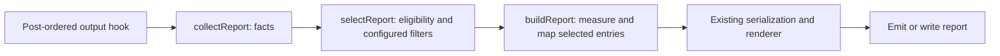

# Opt-in asset reporting

- Author: Denis Bardadym
- Status: Deferred pending more mature Rolldown native CSS support. Implementation requires separate authorization.
- Date: 2026-11-12
- Updated: 2026-11-19
- Issue: [CSS files reported as zero-length (#203)](https://github.com/btd/rollup-plugin-visualizer/issues/203)
- Code baseline: `c0ebd7561df504d67e3fc135e53a16f222fb2a01` (reconciled from `cb1bad2`).
- Review findings, disposition, and evidence limits are recorded [below](#review-record).

This design is retained for a future session; implementation is postponed. It does not authorize
production changes or commits. Requirements below describe the proposed feature, not an
implementation already tested.
Follow [repository instructions](../AGENTS.md) and reconcile the code baseline before editing.

## CSS support across supported bundlers

Checked on 2026-11-19. This distinguishes standalone bundler support from the CSS pipeline that
Vite provides on top of its bundler. Recheck these sources when revisiting the feature.

| Host | Current CSS support | Sources |
| --- | --- | --- |
| Rollup 4 | Core does not provide a built-in CSS processing/extraction pipeline. CSS is handled by plugins, which can emit separate stylesheets, embed styles in JavaScript, or preserve CSS imports depending on the plugin and configuration. | [Rollup's CSS plugin catalog](https://github.com/rollup/awesome#css). |
| Standalone Rolldown 1 | The previous experimental native CSS implementation was removed. The 2026-02-25 update says CSS bundling behavior is being reconsidered through user feedback and recommends Vite 8 for CSS needs. The tracking issue remains open. CSS handling through plugins is still possible; this does not establish mature native support. | [Native CSS feedback, #4271](https://github.com/rolldown/rolldown/issues/4271). |
| Vite 8 | Vite supplies CSS imports, CSS Modules, development style injection with HMR, and production CSS extraction/code splitting. Its internal pipeline includes `cssPlugin` and `cssPostPlugin`. `build.cssCodeSplit: false` combines extracted CSS into one file; library builds default to that setting. This support is provided by Vite even though its underlying bundler is Rolldown. | [CSS features](https://vite.dev/guide/features#css), [CSS build splitting](https://vite.dev/config/build-options#build-csscodesplit), [Vite 8.3.5 plugin pipeline](https://github.com/vitejs/vite/blob/v8.3.5/packages/vite/src/node/plugins/index.ts). |

For this design, a separately emitted stylesheet would enter the proposed asset-reporting path.
CSS embedded in JavaScript stays in the existing JavaScript measurement path; independently
copied files outside the bundler output remain outside scope. The earlier Vite probes exercise
Vite's CSS pipeline and do not establish native CSS behavior in standalone Rolldown.

## Current decision: defer implementation

On 2026-11-19, the maintainer chose to postpone this feature until Rolldown's native CSS support
is more mature, given the upstream state described above.

This is a prioritization decision. The proposed emitted-asset mechanism can measure assets
produced by plugins without native CSS support; native support is not a technical prerequisite.
Retain the design and evidence for later reassessment, with no implementation scheduled. When
revisited, recheck upstream CSS behavior and the code baseline before treating this plan as current.

## Outcome and scope

Add `includeAssets?: boolean`, default `false`, to report emitted assets alongside JavaScript
output. Use the bundler's actual asset contents, existing filters, and existing file presentation.
Support all emitted asset types through the same string/binary source contract.

For issue #203, success means that enabling asset reporting exposes the emitted stylesheet with
its actual byte and enabled compression sizes. The original source CSS module can still report
zero JavaScript bytes. This feature does not assign a combined stylesheet's bytes to individual
source files or create a source-to-asset dependency relationship. With asset reporting disabled,
stylesheet assets remain omitted. Describe this as **emitted stylesheet reporting**, not a promise
to correct every original CSS file's size.

Whether this representation is sufficient to close issue #203 remains a product judgment; the
issue alone does not establish that the reporter accepts it.

The reproduction emitted 16 UTF-8 bytes of CSS. With compression enabled, the proposed report
would contain an ordinary output entry for that stylesheet; its raw and compressed lengths must
match its emitted content. Source-module measurements remain separate.

Out of scope: source attribution, source-file rereading, CSS parsers, assets copied outside the
bundler output, a report registry, mobile layouts, new chart controls, and dependency replacement.
Do not add Rollup 2/3 tests or compatibility shims. Changing published peer metadata is separate.

## Evidence and rationale

The [pinned reproduction](https://github.com/mrginglymus/rpv-css/tree/ce9809d5eda03e4ad6853d5f473867464224f7cc)
was rebuilt with visualizer 5.14.0, Vite 6.3.3, and Rollup 4.40.0, and the case was repeated with
visualizer 7.1.3, Vite 8.3.5, and Rolldown 1.2.16. Both omitted the emitted stylesheet's bytes.

Vite [returns empty JavaScript for ordinary extracted CSS](https://github.com/vitejs/vite/blob/v6.3.3/packages/vite/src/node/plugins/css.ts#L575-L600)
and later [emits and cleans up CSS assets](https://github.com/vitejs/vite/blob/v6.3.3/packages/vite/src/node/plugins/css.ts#L935-L1013).
The visualizer's current collection skips output assets. Source-map mode does not recover the
extracted CSS in the tested builds. `originalLength` cannot substitute for emitted content: the
reproduction's source length was 25 while the emitted CSS was 16 bytes. That Rollup field uses
UTF-16 code units; a non-ASCII fixture measured 33 such units versus 36 UTF-8 bytes.

Hook ordering also matters. At the existing ordinary generation hook, split CSS still contained a
temporary marker (28 bytes before cleanup, 16 afterward). Unsplit CSS had not yet been emitted.
A sequential hook cannot wait for subsequent handlers by delaying inside its own handler.

Six design-time builds checked a post-ordered observer against the actual returned asset contents:

| Toolchain | Fixture and observation |
| --- | --- |
| Rollup 4.67.5 | An ordinary producer placed after the observer mutated text and emitted late JSON. The post observer saw final text, binary view bytes, and JSON. |
| Rolldown 1.2.16 | The same standalone producer assertions passed. |
| Vite 6.3.3 with Rollup | Split and unsplit CSS, HTML, manifest, and SSR manifest matched returned assets at the post hook. |
| Vite 8.3.5 with Rolldown | The same two Vite configurations matched returned assets. |

No Vite `enforce` property was needed in these fixtures. This supports the chosen common hook; it
does not prove every later plugin is observed or that the asset feature already passes its tests.

The [holistic review](#review-record) also reproduced a concrete list-renderer failure
for output-membership keys `constructor` and `__proto__`. It identified a missed direct hook caller
and ambiguous Markdown count terminology. Those corrections are included below.

## Behavior contract

This table is the authoritative behavior definition. The [acceptance criteria](#acceptance-criteria)
state how to verify it; other sections describe the mechanisms implementing it.

| Concern | Required behavior |
| --- | --- |
| Eligibility | Omitted/false `includeAssets` excludes assets regardless of include patterns. True considers every emitted asset type, without suffix-based eligibility. |
| Configured selection | Apply existing include/exclude rules in `selectReport` only. For an asset, both `bundle` and `file` receive its exact emitted filename. Exclusions win; include entries are alternatives; fields in one entry must both match. |
| Measurement | Strings use UTF-8 bytes. Binary sources use the exact bytes of their view, not the rest of a backing buffer. Enabled compression consumes those same bytes with existing parameters. |
| Empty content | Empty strings and zero-byte binary sources have all three lengths zero and bypass compression, matching existing empty modules. These values do not claim to include empty-stream framing overhead. |
| Compression flags | Disabled compressed lengths remain zero. Existing source-map mode disables gzip/Brotli for the whole report, while assets still use their emitted byte length. |
| Ownership | Count each emitted output filename once per output bundle. Distinct filenames remain distinct even when contents match. Source-module identities and asset identities remain separate. |
| Lifecycle | Use one post-ordered `generateBundle` handler for the whole report. Resolve callback options once per output. Retain last-plugin guidance, in-memory generation, `emitFile`, direct file and link output, and existing opening/filename validation behavior. |
| Multiple reports | Earlier emitted reports are ordinary eligible assets. Users exclude them with existing patterns. A newly generated report is absent from its own preceding collection pass. Direct file writes do not themselves add bundle assets. |
| Schema | Retain version 2, existing fields/flags, and UID-based references. Do not serialize an asset marker or `includeAssets` flag. |
| Presentation | Add ordinary root-level file leaves beside output chunks. Use emitted filenames and existing colors, layout, metrics, tooltips, and interactions. No new asset panel, palette, grouping, or filter language. |
| Text interpretation | Preserve text-report structure and labels, with an explicit Markdown note that Modules/Hot Modules count measured entries, including emitted assets, and bundle counts include represented output files. |
| Network | Use ordinary nodes and existing size-dependent layout. Asset import lists are empty, so nodes may be disconnected. Preserve the current filename/importer tooltip; this feature does not add exact-size inspection or explain why an asset was included. |
| Filtering visibility | Unselected entries produce no measured parts, tree leaves, or metadata. Interactive visibility filtering remains independent and can only operate on collected report entries. |
| State | Use fresh selected-report/mapping state per output generation. Do not deduplicate by filename across reports, outputs, or rebuilds. Preserve existing CLI hash/UID merge behavior. |

Rendered totals combine existing JavaScript estimates with emitted asset bytes. They are not a
promise of exact application transfer size; summed individual compression sizes are not the
compressed size of the application. Source maps and earlier reports can affect totals if included.

### Public examples

Keep JavaScript output and add CSS/SVG assets:

```js
visualizer({
  includeAssets: true,
  include: [
    { bundle: "**/*.js" },
    { file: "**/*.css" },
    { file: "**/*.svg" },
  ],
});
```

When emitting several reports, exclude their chosen output directory if they should not measure
one another:

```js
visualizer({
  filename: "reports/stats.json",
  template: "raw-data",
  emitFile: true,
  includeAssets: true,
  exclude: [{ file: "reports/**" }, { file: "**/*.map" }],
});
```

Only an earlier instance needs `emitFile: true` for its report to enter the bundle. A later report
can measure that asset even if the later instance writes its own report directly. Do not identify
reports through contents, private markers, filenames reserved by the plugin, or a shared registry.

## Extend the existing pipeline

The baseline already has [collection, selection, and building](../plugin/report.ts), called from
[the plugin](../plugin/index.ts). Keep those boundaries. An older draft's mapper predicate and
inline filtering instructions were superseded by this pipeline; do not restore them.



### Collection

Extend `CollectedReport` with an `assets` array. Each internal asset record contains its exact
output-bundle key as `id` and its string/`Uint8Array` `source`. Enumerate output assets once in
`collectReport`, alongside the existing chunk facts. Do not apply `includeAssets`, include/exclude,
project-root trimming, compression, or source attribution here. Preserve collected facts so more
than one selection can reuse them, as the existing report-stage tests require.

### Selection

Extend `SelectedReport` with an `assets` array. Add an optional fourth `includeAssets` boolean
argument, default false, to `selectReport(collected, include, exclude, includeAssets)` so existing
three-argument calls preserve their behavior. This function alone owns asset eligibility and
configured filtering, using `matches(asset.id, asset.id)` from the existing shared matcher.

Keep existing JavaScript selection, missing-attribution fallback decisions, and dependency pruning.
Asset records do not enter the source-module map or source graph. A same-named source module must
not make an asset eligible or vice versa. Do not mutate the collected report.

### Building and serialization

`buildReport` consumes the selected assets without another eligibility or filter check. Extend its
measurement callback input to accept binary data as well as existing string/null contributions.
Measure each selected asset's source, register its part, and add its leaf after the existing chunk
roots. Preserve the current source-map contribution path and source graph construction.

Keep a fresh mapper per report. Complete source-module mapping through existing APIs, then add
asset identities through the contract below. Serialize the existing tree, parts, and metadata.
Neither the mapper nor serializers receive include/exclude rules or decide eligibility again.

In `visualizer`, preserve the current per-output resolution of the factory's original option
object/callback and its existing callback deprecation warning. The earlier callback replacement
defect has already been fixed in this baseline; asset settings must follow the same local option
object without leaking into later outputs. Do not resolve options in an earlier hook merely to
select scheduling.

Preserve the current `output: "link"` path, including template validation, the `emitFile`
restriction, logging, and opening behavior. Assets use the same selected report and unchanged
share codec; link output itself creates no bundle asset. Check encoding and decoding with real
asset-bearing reports rather than assuming schema reuse proves consumer compatibility.

### Hook placement and its boundary

Use object-form `generateBundle` with `order: post`, its existing context/output arguments, and a
single handler for both JavaScript and assets. Keep the README's last-plugin guidance to order
against other user post hooks. Do not move collection to `writeBundle`, split collection across
hooks, or add a public timing option. Rollup validation targets version 4; no legacy hook detection
or fallback is required. Keep published types structural and independent of installed bundlers.

Post hooks remain ordered relative to one another. The report observes asset contents available
when its handler runs, not changes made by later hooks. The post position also affects reports
with asset collection disabled; their output can reflect later generation state than before.
Document that boundary instead of promising no observable change for every integration.

## Asset identity and mapping

In [ModuleMapper](../plugin/module-mapper.ts), retain source-module storage and add a private
`Map` keyed by emitted filename for asset storage. Share the current UID allocator and size-part
table. A separate map prevents collisions with source IDs, including virtual IDs; do not use an
internal prefix that can leak into labels or filters.

Define `setAssetPart(fileName: string, lengths: ModuleLengths): ModuleUID` with this contract:

- Input has already passed selection. Do not filter or resolve paths inside this operation.
- Allocate a metadata UID and part UID using the existing allocator. Return the part UID.
- Metadata has `id` equal to the exact filename, one `moduleParts` membership mapping that filename
  to its part UID, and empty import/importer collections. Leave entry/external flags unset.
- Store the lengths and metadata reference in the shared part table. Reject duplicate registration
  of the same asset filename within this mapper, following existing duplicate-part protection.
- Export source and asset metadata keyed by their distinct UIDs through `getNodeMetas()`; preserve
  source-only lookup/link APIs. Do not add a metadata inclusion predicate.

The builder adds an ordinary leaf whose `name` is the exact emitted filename and whose `uid` is
that part UID. Do not call source-module tree construction for the asset: it would repeat the
filename inside a synthetic one-child hierarchy. Do not apply `projectRoot` trimming to the asset.

Same-named source and asset entries can share displayed text and match the same name filter. They
must retain different UIDs and byte ownership. Two filenames with identical bytes remain two
emitted files. CLI merging retains the existing per-report hash/UID semantics; do not introduce
cross-report filename deduplication.

## Consumer compatibility and interpretation

Reuse existing rendering paths, correcting demonstrated incompatible assumptions. Reusing a
serialized shape is not proof that every consumer accepts its new output identifiers.

The [list renderer](../plugin/render-template/list.ts) currently groups output memberships in an
ordinary object. Both `constructor` and `__proto__` resolve inherited properties and make its
subsequent array `push` throw. Change this grouping dictionary to an object without a prototype,
using the existing pattern in [network data](../src/network/data.ts). Preserve sorting and text
output. Include direct list-rendering assertions for both filenames; do not restrict asset names.

The [Markdown renderer](../plugin/render-template/markdown.ts) counts measured metadata rows as
Modules/Hot Modules. Keep its headings, columns, and layout, but add this meaning to its existing
Notes section: **Modules and Hot Modules list measured report entries, which can include emitted
assets. Bundle counts include represented output files.** No new kind field is needed for that
explanation. Existing report data must remain readable by the CLI and every template.

Adjust existing measurement explanations in treemap, flamegraph, and Markdown to distinguish the
selected JavaScript estimation mode from direct asset bytes. Keep asset presentation ordinary.
Do not add a new network inspector, source relationship, asset badge, or display-name prefix.
Zero-byte entries follow existing template behavior; do not invent minimum chart area for assets.

## Alternatives and priorities

Accurate emitted-byte ownership and truthful attribution have the most weight. Next are preserving
output modes, compatible consumers, and consistent user control across hosts. Appearance should
remain familiar, but does not override verified correctness failures. Do not score agent workload,
implementation time, or line count.

| Approach | Decision and technical reason |
| --- | --- |
| Explain the limitation without collecting assets | Leaves real stylesheet output invisible. Documentation alone does not provide the agreed outcome. |
| Collect CSS only | Adds a type/filename restriction to a uniform asset-source API without a demonstrated correctness benefit. |
| Opt-in assets, existing model, post hook | Selected: measures emitted contents, retains output modes and filters, and keeps source attribution honest. |
| Substitute `originalLength` or infer source CSS shares | Rejected: source text does not establish transformed/combined output bytes or compressed contents. |
| Exact source attribution | Separate use case requiring reliable producer mappings, not a prerequisite for emitted-file reporting. |
| Collect after writing | Does not preserve in-memory generation or the current report-emission flow. |

## Implementation file plan

Paths are relative to this document. Modify only the necessary behavior described here; preserve
unrelated work. The [acceptance criteria](#acceptance-criteria) are the single verification checklist.

| File | Planned change and reason |
| --- | --- |
| [plugin/bundler-types.ts](../plugin/bundler-types.ts) | Add asset source typed as string or `Uint8Array`; describe the object-form post hook with its existing structural arguments. Keep bundler imports and host-specific types out of published declarations. |
| [plugin/report.ts](../plugin/report.ts) | Extend collected/selected reports with asset arrays, select them only in `selectReport`, widen measurement input, and build asset leaves through the mapper. Preserve current JavaScript selection and graph pruning. |
| [plugin/index.ts](../plugin/index.ts) | Add documented `includeAssets`, adopt the ordered handler, preserve local option resolution per output, pass eligibility into selection, and extend byte measurement to binary/empty contents. Retain rendering, emission, and link output flow. |
| [plugin/compress.ts](../plugin/compress.ts) | Accept string or `Uint8Array`, encode only strings as UTF-8, preserve binary view boundaries, and retain existing compression parameters. |
| [plugin/module-mapper.ts](../plugin/module-mapper.ts) | Implement the separate asset map and `setAssetPart` contract; export the unchanged schema without selection policy. |
| [plugin/render-template/list.ts](../plugin/render-template/list.ts) | Use a prototype-free grouping dictionary so required asset filenames render safely without changing output layout. |
| [plugin/render-template/markdown.ts](../plugin/render-template/markdown.ts) | Clarify measured-entry counts and measurement modes in Notes; retain headings, table structure, and compression policy. |
| [src/treemap/tooltip.tsx](../src/treemap/tooltip.tsx), [src/flamegraph/tooltip.tsx](../src/flamegraph/tooltip.tsx) | Adjust existing explanatory text for mixed JavaScript estimates and asset bytes; preserve appearance and interactions. |
| [test/add-links.test.ts](../test/add-links.test.ts) | Invoke the object hook's handler and preserve graph assertions. |
| [test/filtering-fixture.ts](../test/filtering-fixture.ts) | Adapt its direct `generateBundle` invocation. Preserve deliberate copied-chunk attribution tests and wrapper scheduling metadata; use separate real-host tests to prove actual post ordering. |
| [test/report.test.ts](../test/report.test.ts) | Extend existing stage-boundary tests: reusable collected assets, default-off selection, selected-state immutability, excluded assets not measured, and no filtering in building/export. |
| [test/types/assignability.ts](../test/types/assignability.ts) | Exercise asset-enabled options/callbacks and the ordered hook against all three hosts, retaining default plugin assignment checks. |
| [Rollup consumer](../test/fixtures/rollup-consumer/consumer.ts), [Rolldown consumer](../test/fixtures/rolldown-consumer/consumer.ts), [Vite consumer](../test/fixtures/vite-consumer/consumer.ts) | Exercise the new option through existing isolated consumer type checks, without fixture dependency changes. |
| Create `test/assets-fixture.ts` | Reuse patterns from current bundler fixtures for real emitted assets, report parsing, and UID-based assertions. Close bundles and clean private temporary directories. |
| Create `test/assets.test.ts` | Cover the shared contract on standalone Rollup/Rolldown, identity, compression, selection, report instances, callback outputs, and output modes. |
| Create `test/assets-vite.test.ts` | Use real temporary HTML/JS/CSS builds. Default to installed Vite; allow test-only `VISUALIZER_TEST_VITE_ENTRY` to rerun with isolated Vite 6.3.3 without a permanent dependency or normal-test downloads. |
| Create `test/assets-templates.test.ts` | Render real bundler-derived asset data through all registered templates, including Markdown and 3D treemap; cover list special names, text interpretation, network conversion, and shared interactive matching. |
| [test/cli.test.ts](../test/cli.test.ts) | Merge independently generated reports with same-named assets; verify UIDs, parts, memberships, and existing merge semantics. |
| [test/share-plugin.test.ts](../test/share-plugin.test.ts) | Exercise asset-enabled link output and decode the resulting report; preserve asset names, sizes, and UID memberships, including special filenames. Retain existing callback and output-mode assertions. |
| [README.md](../README.md) | Document option/default, emitted-filename filtering, source-module versus output sizes, report-instance handling, and measurement limits. Retain last-plugin guidance. |
| [CHANGELOG.md](../CHANGELOG.md) | Add a brief user-visible entry for optional emitted-asset reporting. |
| [This design](./asset-reporting.md) | Record actual implementation verification and evidence-based deviations after implementation is separately authorized. |

If explanatory text changes generated HTML snapshots, refresh the affected supporting snapshots
in `test/__snapshots__/e2e.test.ts.snap`, `e2e-rolldown.test.ts.snap`, `gh59.test.ts.snap`,
`gh69.test.ts.snap`, and `gh93.test.ts.snap`. Inspect differences; snapshots do not replace direct
assertions. Additional files are warranted only by a demonstrated need, not by speculative scope.

Do not change package dependencies, report version/schema, CLI merging implementation, chart
layout algorithms, or styling unless a concrete incompatibility requires a reviewed design change.
The verified list dictionary correction above is part of the plan, not an exception to hide.

Implement in dependency order: structural types and compression; mapper; report stages and plugin;
consumer corrections; tests and documentation. Retain current source filtering stage tests throughout.

## Fixture inputs

Use actual Rollup/Rolldown output, with a virtual JavaScript entry `/asset-fixture/entry.js`
containing `console.log("asset fixture");`. A producer emits assets through `emitFile` in
`buildStart`. An ordinary generation hook changes `mutable.txt` and emits `late.json`; place this
producer after the visualizer in one test to verify post ordering independently of array placement.

| Asset filename | Producer source |
| --- | --- |
| `assets/style.css` | `body { color: red; }` followed by LF. |
| `assets/icon.svg` | `<svg><text>é😀</text></svg>` followed by LF. |
| `assets/data.json` | `{"message":"é😀"}`. |
| `index.html` | `<p>application</p>`. |
| `assets/image.png` | Bytes containing `0xff`, zero, and `0xfe`; a binary-contract fixture, not a claim to encode a valid image. |
| `assets/font.woff2` | Backing bytes `[7, 255, 0, 254, 8]`, with a `Uint8Array` view covering `[255, 0, 254]`. Expected view length: 3 bytes. |
| `empty.txt`, `empty.bin` | Empty string and empty `Uint8Array`, respectively. |
| `constructor`, `__proto__` | Nonempty text. |
| `mutable.txt` | Initial `before`, replaced by `after é😀` in the ordinary generation hook. |
| `late.json` | `{}`, emitted by that ordinary hook. |

Also emit two filenames with identical contents and import one source module from multiple entries.
For identity collision coverage, use a real source-module ID equal to an asset filename, and a
`projectRoot` that makes the displayed names coincide. Assert ownership by UID, not by name alone.

For Vite, create a private temporary root with:

- `index.html`: `<script type="module" src="/index.js"></script>`.
- `index.js`: `import "./style.css"; console.log("fixture");`.
- `style.css`: `body { color: red; }` followed by LF.

Set `configFile: false`, `modulePreload: false`, `manifest: true`, and `ssrManifest: true`.
Run with CSS splitting true and false, then CSS as the only entry through the host's bundler input
configuration. Add an inline-CSS control importing `./style.css?inline`; it must not invent a CSS
asset. Use actual returned filenames and contents as oracles rather than fixed hashes or input
lengths. The observed fixture minified to 16 bytes; the asset source remains the primary oracle.

## Acceptance criteria

This is the authoritative checklist for implementation verification. Assertions must test behavior
directly. Actual feature integration results have not yet been obtained.

| ID | Assertions |
| --- | --- |
| A1: Eligibility | Omitted/false `includeAssets` selects no assets even with matching include patterns. True accepts all matching asset types, including extensionless filenames. |
| A2: Stage boundaries | Reuse one collected report for multiple different selections without mutation. Selected state is unchanged by building. Spy on measurement to prove unselected assets are never measured. No include/exclude policy runs in collection, measurement, mapping, or serialization. |
| A3: Data ownership | Each selected asset has one root leaf, part, metadata record, and output membership; excluded assets have none. All UID references resolve. Asset imports/flags follow the mapper contract. |
| A4: Bytes and compression | Raw sizes equal actual UTF-8/binary source lengths, including non-ASCII text/names, invalid UTF-8 bytes, and sliced views. Nonempty compressed lengths match direct Node zlib output with current plugin parameters, not the plugin helper as an oracle. Empty sources have three zero lengths. Disabled/source-map-mode compression remains zero. |
| A5: Selection and visibility | Test file-only, bundle-only, combined-field, include-list, and exclusion-precedence cases. Asset-only includes must not reintroduce JavaScript via fallback or graph metadata. Existing interactive filters match emitted filenames and cannot recover omitted assets. |
| A6: Identity and counts | Same-named source/asset nodes retain distinct UIDs and byte ownership; source links target source UIDs. Distinct output filenames with identical bytes remain distinct. Multiple references do not multiply an asset's contribution. |
| A7: Timing and CSS | Post collection sees mutations and late assets from ordinary producers on standalone Rollup/Rolldown. Real Vite split/unsplit/CSS-only reports match emitted CSS bytes and compression. HTML and enabled manifests are eligible. Inline CSS creates no invented output entry. |
| A8: Several reports | With real instances, an earlier emitted report is included unless excluded. Unrelated HTML/JSON remains eligible. Mixed `emitFile` modes follow the contract, and each report excludes its own newly generated content through sequencing alone. |
| A9: Outputs and reset | Repeat generation and multiple outputs where supported. Resolve callback options once per output; filenames, eligibility, and mapper state must not leak between outputs or rebuilds. |
| A10: Consumers | All registered templates accept bundler-derived asset data and retain names, byte ownership, memberships, and existing presentation. The list template handles both special filename keys. Markdown includes the explicit measured-entry/count definition. Raw data retains version 2 and no new serialized fields. |
| A11: CLI | Merge independently generated reports with the same asset filename. Preserve existing UID/hash semantics and each retained asset membership; do not deduplicate by displayed name. Existing report files remain compatible. |
| A12: Output modes | Exercise in-memory generation and writing, `emitFile` and direct report writes, link output with decoded asset data, current filename validation, and opening conditions. Isolated consumer checks pass without requiring another bundler to resolve published types. |

## Verification matrix and commands

| Target | Required execution |
| --- | --- |
| Standalone Rollup 4 | Shared fixture and applicable A1–A12 checks through actual bundler output. No Rollup 2/3 matrix or shim. |
| Standalone Rolldown 1 | Shared fixture independently of Vite; do not infer its behavior from Rollup results. |
| Installed Vite with Rolldown | Vite fixture and applicable shared cases using the installed dependency. |
| Vite 6.3.3 with Rollup 4.40.0 | Rerun the Vite suite using an isolated historical installation and the same fixture inputs; do not add a second permanent dependency. |

After separately authorized implementation:

1. Run `npm run build` before tests, which consume generated `dist` files.
2. Run `npm test` for types, unit/integration tests, and isolated consumer fixtures.
3. Run `npm run lint`.
4. Run `npx tsc -p src/tsconfig.json --noEmit` because measurement-help edits affect frontend files.
5. For the historical Vite run, create a private temporary npm prefix and install Vite 6.3.3 and
   Rollup 4.40.0 using `--ignore-scripts --no-package-lock --no-audit --no-fund`. Set
   `VISUALIZER_TEST_VITE_ENTRY` to its `node_modules/vite/dist/node/index.js`, then run
   `npx vitest run test/assets-vite.test.ts`. Normal tests must not download these packages.
6. Generate all five HTML diagrams from an asset-bearing bundle and inspect ordinary file labels,
   metrics where supported, tooltip wording, and filtering. Include a narrow desktop window,
   browser zoom, mixed JavaScript/assets, and empty-only inputs using existing zero-size behavior.
   Record outcomes; do not claim an exact-size network inspector or fabricate minimum chart area.

The earlier investigation encountered an unavailable registry dependency during consumer fixture
installation. Run current checks and report actual failures rather than treating that historical
result as a pass or a permanent blocker. No benchmark, mobile layout, asset parser, or exhaustive
third-party plugin matrix is required. If verification reveals a concrete incompatibility requiring
an architectural or public-behavior change, present the evidence and revise the design with the
author; do not invent a new requirement or silently widen the scope.

## Review record

### 2026-11-12: holistic review and re-audit

The review supported opt-in emitted-asset reporting through the existing model, subject to the
corrections below. Its alternatives and relative priorities are retained in
[Alternatives and priorities](#alternatives-and-priorities).

| Finding | Disposition in this design |
| --- | --- |
| The source CSS node can remain zero, so the issue outcome needs precise wording. | Outcome is emitted stylesheet reporting; source attribution stays outside scope. Reporter acceptance remains unconfirmed. |
| The list consumer fails on required output-membership keys. | Plan a prototype-free dictionary and direct regression assertions; do not restrict filenames or change the schema. |
| Markdown's Modules/Hot Modules and bundle counts become ambiguous. | Define measured entries and represented output files in the existing Notes section. |
| The object-form hook migration omitted a direct caller. | Include both `test/add-links.test.ts` and `test/filtering-fixture.ts`; keep real-host ordering tests separate. |
| Repeated contracts and superseded instructions risk conflicting guidance. | Keep one behavior contract and one acceptance checklist; follow collection, selection, and building boundaries. |

The primary review session reproduced the list failure against the built renderer with valid
schema-shaped data, independently supported by source inspection:

| Output-membership key | Recorded result |
| --- | --- |
| `assets/style.css` | Rendered a three-byte entry. |
| `constructor` | Threw `TypeError: bundles[bundleId].push is not a function`. |
| `__proto__` | Threw the same error. |

Two fresh-conversation, read-only EGM reviewers examined the design, repository instructions,
README, and relevant source; neither built code or consulted external pages. The primary session
also reread the issue and reproduced the list failure. A subsequent read-only re-audit found no
remaining substantive inconsistency within its scope after the design revision. It checked the
pipeline, mapper, consumers, hook callers, and report-stage tests, without building or testing.

These results support the design, not implementation readiness proved by integration tests. The
six hook probes in [Evidence and rationale](#evidence-and-rationale) are separate design-time
evidence. No asset-feature implementation, benchmark, or complete regression suite was performed
for the review. Arbitrary later plugin behavior remains outside the demonstrated evidence.

### 2026-11-19: consolidation and baseline reconciliation

Merged the separate review into this design because its substantive corrections were already
incorporated. Removed duplicated rationale, limitations, and recommendations while retaining the
findings, reproduction results, review scope, and unresolved issue acceptance above.

Source inspection against `c0ebd7` confirmed the collection/selection/building pipeline, list
dictionary assumption, Markdown terminology, and both direct hook callers. Comparing the old
baseline with current code also showed that callback options are now resolved locally per output
and `output: "link"` is implemented. Updated the handoff to preserve that behavior and cover
asset-bearing link output. This consolidation did not repeat the historical external
reproductions, hook probes, or list runtime reproduction, or run the implementation checks.

### 2026-11-19: implementation deferred

The maintainer postponed the feature pending more mature Rolldown native CSS support. Recorded
the upstream removal of experimental CSS support and the distinction between Vite's plugin
pipeline and standalone Rolldown. The design remains a proposal for later reassessment.

### 2026-11-19: CSS support context added

Added a dated, source-linked comparison of Rollup 4, standalone Rolldown 1, and Vite 8 near the
top so future reassessment can distinguish plugin-provided CSS handling from native support.
Consolidated the upstream CSS status there without changing the deferral decision.

*Drafted and reviewed with EGM; review findings consolidated into this design.*
