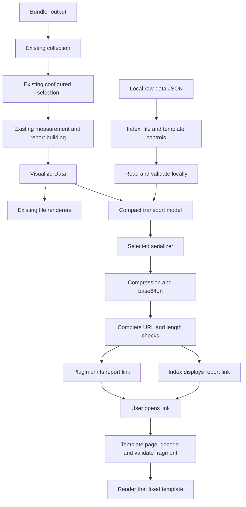

# Static report viewer and shareable report links

- Author: Denis Bardadym
- Status: Implemented locally; deployment and public smoke verification pending.
- Date: 2026-11-13
- Updated: 2026-11-14
- Code baseline: `cb1bad2be80f4e02db9bead0a0c95573e90f2ca3`.

This document covers two related features: a GitHub Pages viewer for local raw-data files, and
an optional plugin output mode that prints a link containing a report. It records the agreed
constraints and implemented behavior. The author approved a small custom binary format
and native browser gzip. The index always produces a complete link for a valid, supported report;
GitHub sharing limits do not gate generation. The version-1 wire contract below is implemented with compatibility fixtures and bounded parsing.

## Overview

Separate the static site into direct report pages and an index upload-style page. A report link
has the form `/$template/#data` and directly renders that template. The index reads a selected
raw-data JSON file locally, validates it, encodes a complete report URL for the chosen template,
and displays that link when the input and result are valid. The user opens or copies the link.
The index neither renders diagrams nor redirects automatically.

Report data is processed locally. There is no report server, database, upload endpoint, account,
or schema-registry service. GitHub Pages serves application code and assets.

Use a small custom schema-based binary format followed by gzip for shared links. Browsers use
their native compression streams; the plugin uses Node's built-in gzip support. The comparison
with Protocol Buffers and Apache Avro is retained below as the reasoning for the format decision.
Retain the existing raw-data JSON format for files.

The index and template pages can ship before plugin console-link output. Both flows use the
same self-contained transport and native gzip. Local file-to-link generation and browser opening
are the primary workflow. The author explicitly considers GitHub sharing secondary: the index
still generates the link if GitHub cannot accept it, without a GitHub length cutoff or warning.

## The problem

Contributors currently attach HTML or statistics files to issues. The maintainer downloads and
inspects them, sometimes extracting raw-data from HTML first. Sharing and investigating a report
requires more steps than opening an ordinary issue link.

An embedded-data link removes those steps for reports that fit. A static file viewer makes
raw-data attachments usable without running the CLI. The file path still requires downloading
an attachment; it does not itself provide one-click viewing from an issue.

## Goals

1. Let recipients open complete report links directly in the selected diagram.
2. Let recipients select current plugin-generated raw-data JSON on the index and obtain a link
   that opens the chosen diagram.
3. Keep report data out of network requests and application-managed persistent storage.
4. Preserve report contents: paths, measurements, flags, hierarchy, bundle membership, and
   dependency relationships. Compression must not remove inconvenient or expensive nodes.
5. Reuse existing diagrams, measurements, and interactive visibility filters. A link fixes its
   diagram type; existing zoom/filter interactions do not imply switching diagram types.
6. Leave ordinary file output as the plugin default.
7. Verify link generation and browser decoding on supported reports, including large fragments.

Raw-data remains the file supplied to the index. Successful validation and encoding produce a
complete report link regardless of a destination site's paste/rendering limits. File/decoded-data
resource budgets still apply; third-party URL acceptance is not a feature acceptance criterion.

## Non-goals

- Hosting reports, issuing short links, uploading file contents to a server, or introducing a backend.
- Rendering diagrams on the index or navigating away automatically after generating a link.
- Importing or executing generated HTML. Ask contributors to generate raw-data JSON instead.
- Fetching report URLs, GitHub attachments, gists, or private repositories from the viewer.
- Replacing the raw-data JSON format with a binary file format.
- Implementing the production codec before comparing candidates. Do not count an opaque custom
  payload inside a standard serializer as an evaluation of that standard format.
- Comparing or merging multiple files in the viewer, adding CLI sharing flags, or capturing
  interactive filters and zoom in links in the first release.
- Changing size calculation, configured include/exclude semantics, or chart layout algorithms.
- Diagram switching or navigation controls on direct report pages. Index-page controls are a
  separate feature and are not subject to that restriction.
- Mobile layouts, report persistence, analytics, or automatic report expiration.
- Guaranteeing that GitHub or another destination accepts a pasted URL, or gating generation
  on those external limits.

## Decisions and proposals

| Item                                                                                     | State                                                      |
| ---------------------------------------------------------------------------------------- | ---------------------------------------------------------- |
| Static GitHub Pages application; no report service                                       | Agreed constraint                                          |
| Raw-data JSON as the local index input                                                   | Agreed direction                                           |
| Schema-based binary representation                                                       | Agreed direction                                           |
| One version character selects the complete decoding profile; payload is always base64url | Agreed constraint                                          |
| Small custom fixed-schema binary format                                                  | Agreed after comparing generated codecs                    |
| Native browser gzip for compression and decompression                                    | Agreed; no bundled compressor or compression polyfill      |
| Separate direct template pages and index controls                                        | Agreed separation                                          |
| Index reads a local file and displays its generated report link; user opens it           | Agreed flow                                                |
| Explicit link output mode, preserving current file output by default                     | Proposed API below                                         |
| Preserve UID labels and ordering initially                                               | Proposed fidelity policy, consistent with current behavior |
| Complete index link regardless of GitHub paste/rendering limits                          | Agreed; no destination cutoff or warning                   |
| File/decode resource limits and browser interoperability                                 | Release-blocking validation tasks                          |

Each report link fixes one diagram type through `/$template/`, like a generated HTML file.
The index is the file-to-link entry point: validate and encode locally, then display the completed
report link. Report rendering happens only when the user opens that link.

The index upload-style UI processes files in the browser. No file bytes are uploaded to a server.

The proposed contracts below are reviewable choices, not decisions already approved by the author.

## Evidence and its limits

The investigation scanned 163 public issues, 57 pull requests, and 650 accessible comments, then
retrieved available reports. Some attachments are duplicates or old formats; the sample is not a
population estimate of report sizes or successful link coverage.

The following results are for experimental, custom schema-based code, **not Protobuf or Avro**.
Both columns include compression and base64url encoding and exclude the viewer address. Units
are ASCII characters. JSON was compacted before Brotli quality 11 compression.

| Source report                                                                              | JSON + Brotli | Custom binary prototype, preserving report data and ordering |
| ------------------------------------------------------------------------------------------ | ------------: | -----------------------------------------------------------: |
| [#103](https://github.com/btd/rollup-plugin-visualizer/issues/103#issuecomment-830020605)  |       179,839 |                                                       29,136 |
| [#108](https://github.com/btd/rollup-plugin-visualizer/issues/108#issuecomment-1002328753) |       177,040 |                                                       73,543 |
| [#115](https://github.com/btd/rollup-plugin-visualizer/issues/115)                         |       140,906 |                                                       51,763 |
| [#210](https://github.com/btd/rollup-plugin-visualizer/issues/210)                         |       117,363 |                                                       57,578 |
| [#120](https://github.com/btd/rollup-plugin-visualizer/issues/120#issuecomment-1268143528) |        25,266 |                                                       10,616 |
| [#152](https://github.com/btd/rollup-plugin-visualizer/issues/152)                         |        18,928 |                                                        8,627 |

The 16,312,285-byte file from #103 contains only 760 distinct module paths among 31,007 node
records. Explicit deduplication accounts for much of its reduction. Its original byte size does
not establish how another large application will compress.

The prototype also tried canonical UID assignment and ordering. It preserved module data and
relationships but changed ordering, producing 60,007, 42,763, and 45,036 payload characters for
#108, #115, and #210. This policy is not assumed for the initial transport.

Direct checks of GitHub's Markdown rendering API preserved 32,768-character ASCII URLs and
removed the link destination at 32,769 characters. Plain, angle-bracket, and labeled links showed
the same boundary. A synthetic 29,184-character URL with the base64url alphabet survived intact.
This is an observed renderer boundary, not a verified end-to-end browser and terminal limit.
The author subsequently clarified that this boundary must not limit index link generation.

Unicode fragments were percent-encoded by GitHub; they did not provide a denser workaround.
The tested attachment redirects and final responses lacked CORS permission, so fetching an
attachment is not assumed to be a static-only fallback.

Full decoded-data equality was checked on the six experimental reports. Separate checks covered
Unicode paths, dynamic true/false versus absence, zero sizes, and incoming-list ordering. These
checks do not replace tests of the chosen standard library or browser implementation.

## Critical user journeys

### Open a generated report link

- Given: a contributor explicitly selects link output for a visual diagram.
- When: the build finishes and report encoding succeeds.
- Then: the plugin prints one complete URL. A recipient opens it, and the selected template
  page at `/$template/#data` decodes the fragment locally and directly renders that template
  with the report's original data. The page has no diagram selector or file controls.

### Generate a report link from a raw-data file

- Given: a contributor generated `template: "raw-data"` and attached the JSON file to an issue.
- When: the recipient selects or drops that file on the index and chooses the template.
- Then: the index reads and validates the file locally, serializes/compresses the report, and
  displays a complete `/$template/#<version>.<base64url>` link after all checks succeed. The user
  can open or copy it. There is no report upload, index rendering, or automatic navigation.

### Generate a link beyond an external sharing limit

- Given: the index has successfully validated and encoded a supported report.
- When: its complete URL is longer than GitHub or another destination accepts.
- Then: still display the complete link for opening or copying. Do not truncate it, substitute a
  size error, or add a GitHub-specific warning. External paste/rendering failure is outside the
  feature's guarantee. Invalid inputs and exceeded processing budgets remain separate errors.

### Recover from an invalid input

- Given: the index has file/template controls, or a template page is loading a complete link.
- When: input is invalid, incomplete, unsupported, or exceeds resource limits.
- Then: the page shows an actionable error. The index stays open, without a result link for the
  invalid selection. Changing the file or template invalidates any previously displayed result.
  Cancel obsolete work and show only a result matching the latest file/template selection. A
  template page reports link errors with a path back to the index.

## Technical plan

### Data flow and component boundaries



The transport consumes an already selected and measured report. It does not receive include or
exclude configuration, recollect source modules, reread source files, measure sizes again, or
remove nodes. Interactive visibility filtering stays in the diagrams.

### Plugin API and output behavior

Add `output?: "file" | "link"`, default `"file"`. Keep `template` as the report/diagram choice.

```ts
visualizer({
  output: "link",
  template: "network",
  open: false,
});
```

This API is implemented; the public viewer must be deployed before releasing link output.

| Concern                   | Behavior                                                                                                                                                                      |
| ------------------------- | ----------------------------------------------------------------------------------------------------------------------------------------------------------------------------- |
| Default                   | Existing file generation remains unchanged. No hosted-viewer URL is printed by default.                                                                                       |
| Link success              | Print the complete URL through the bundler logger after the report is built. Produce no report file or emitted asset.                                                         |
| Diagram                   | Link output accepts the five existing visual templates. Default remains treemap. Raw-data, list, and Markdown remain file templates.                                          |
| `open`                    | False by default. In link mode, true opens a successfully generated URL. On a size failure it opens nothing.                                                                  |
| `filename` and `emitFile` | `filename` is ignored in link mode. `emitFile: true` is a configuration error; `emitFile: false` is allowed.                                                                  |
| Link length               | Log the complete link without a GitHub-specific cutoff. Index generation always returns the full link for a valid supported report. Processing-budget errors remain separate. |
| Encoding failure          | Encoding and processing-budget failures are plugin errors. Do not silently produce an incomplete report.                                                                      |
| Options callback          | Resolve options once for each output. Keep each output's report, encoder state, and logged URL separate.                                                                      |
| Network                   | Generating a link makes no network request. Browser opening remains explicitly controlled by `open`.                                                                          |

Use the same options for filtering and measurement when explaining raw-data generation. The
instruction must replace link output rather than accidentally leave it enabled. Do not automatically
change source-map or compression-size settings to make a report smaller.

An alternative API is a new link template. It avoids an output option but combines destination
selection with diagram selection. A `share: true` flag is also possible but must distinguish
adding a link from replacing the file. The proposed separate output mode makes replacement explicit.

### Transport model and serialization

The schema describes report contents, not JavaScript implementation objects. Use shared string
tables and integer references so long identifiers and paths do not recur at every relationship.

| Record           | Contents                                                                                                                                                                                   |
| ---------------- | ------------------------------------------------------------------------------------------------------------------------------------------------------------------------------------------ |
| Report envelope  | Title, environment, and report options. The template is selected by the page path and is not duplicated in the payload. The version profile defines the schema and report-version mapping. |
| String table     | Exact strings referenced by paths, identifiers, bundle names, and tree labels. Optional prefix/word representations must be expressed as schema fields.                                    |
| Module table     | Original UID, displayed module ID, entry/external presence and values, and dependency information.                                                                                         |
| Part table       | Original part UID, owning module, bundle association, and the three unchanged size values.                                                                                                 |
| Dependency table | Source/target module references and the presence/value of the dynamic flag. Preserve required ordering information.                                                                        |
| Hierarchy        | The original tree, or an explicitly tagged representation that reconstructs it exactly.                                                                                                    |

These records can use arrays or numeric columns where measurement justifies them. Protobuf packed
numeric fields and Avro arrays provide standard encodings. When evaluating those candidates, use
their actual encodings rather than carrying over the prototype's custom bit-packing parser in
opaque fields. Evaluate the custom format as its own candidate.

Keep absent flags distinct from explicit false. Preserve module and relationship ordering for
the initial contract; do not silently adopt the canonical-order experiment. Preserve dependency-only
nodes, external nodes, empty bundles, and zero-size parts.

Store each dependency once when incoming lists can be reconstructed exactly. Otherwise retain
the ordering/relationship data needed to reproduce both lists. Cycles in the module dependency
graph are valid. Reconstruction must not require that graph to be acyclic.

Tree reconstruction is an optimization candidate, not a requirement to infer hierarchy from paths
in every report. Empty bundles and special leaves need explicit representation. Retain an explicit
tree representation whenever exact reconstruction is not possible. This also avoids depending on
the separately proposed asset feature having only source-module leaves.

Preserve arbitrary current UID strings, including merged reports with more than one UID prefix.
The prototype's common-prefix assumption is not the public format contract. Environment values
must retain their JSON types; stringifying every value is not equivalent.

Wire string lengths and any prefix offsets use UTF-8 bytes or explicitly declared Unicode
positions, never an unspecified character count. Do not normalize Unicode, paths, or identifiers.
Size values are existing report values; transport does not reinterpret or recalculate them. Reject
numeric overflow rather than narrowing large lengths to 32 bits.

### Serializer selection

| Candidate           | Mechanism                                                                                                                            | Technical tradeoff and failure condition                                                                                                                                                                |
| ------------------- | ------------------------------------------------------------------------------------------------------------------------------------ | ------------------------------------------------------------------------------------------------------------------------------------------------------------------------------------------------------- |
| Protocol Buffers    | Numbered fields, variable-length integers, packed numeric arrays, generated TypeScript/browser code.                                 | Supports additive schema evolution, but tags and nested messages add overhead. A faithful schema can still exceed the URL budget. Generated code and runtime must work with the existing build targets. |
| Apache Avro         | Record fields encoded in schema order, without field names or per-field type tags. Generate serializers/deserializers at build time. | Closely matches positional records, but the viewer must retain code for each supported writer schema. Verify the generation toolchain, required runtime helpers, and decoding behavior.                 |
| Small custom format | Fixed schema order, unsigned integer encodings, length-prefixed strings, and measured numeric-array packing.                         | Can match this report model closely with a small browser codec. The project owns the byte specification, validation, and compatibility rules. Keep the supported primitive set narrow and explicit.     |

Compare all three using the same logical compact model and the same fidelity policy. Measure complete
compressed URLs, browser encoder/compressor/decoder bundle bytes, encoding/decoding behavior, peak memory, and
compatibility with the existing build. Prioritize usable link coverage and data fidelity; use
maintenance and browser integration to distinguish candidates with adequate coverage. Do not
claim a winner from raw encoded size alone.

Generate schema-specific serializer and deserializer code at build time. The browser bundle
contains that code and any necessary binary I/O helpers; it does not need `avsc`, its schema
compiler, or runtime schema compilation. A browser `unsafe-eval` requirement from calling
`avsc.Type.forSchema` at runtime is therefore not an inherent Avro tradeoff. Verify a reproducible
ahead-of-time generation path rather than assuming that `avsc` exposes a standalone code export.
Measure the generated bundle for the comparison, not the full build-time tool. Generating code
for an established wire specification does not make the wire format custom.

The viewer ships the required generated code with its assets. Neither standard candidate requires
an RPC server or a registry service here. Select and ship one serializer initially.

Keep the earlier custom prototype as a separately identified baseline. A small custom format is
an ordinary candidate, not a last resort. Compare usable link coverage, fidelity, generated bundle
size, bounded parsing, and compatibility. A fixed application schema and one-character version
dispatch already limit the need for generic schema evolution. Owning a narrow codec is acceptable;
judge its actual specification and tests rather than rejecting it because it is custom. Keep model
improvements separate from wire-format improvements when attributing size differences.

#### Comparison of generated codecs

The 2026-11-14 experiment used the six reports above and the same reversible compact model for
every codec: shared/prefixed strings, exact UID prefix/number tables with literal fallback,
numeric columns, deduplicated legacy records/edges, and exact hierarchy/incoming-list
reconstruction where verified. It retained explicit representations otherwise. The model
preserved original UIDs, record and relationship ordering, flag presence, sizes, and JSON
environment types. Historical adapters were experimental fixtures, not an import-support promise.

These are **complete ASCII URL lengths**, including the proposed
`https://btd.github.io/rollup-plugin-visualizer/network/#1.` prefix and an encoded default title.
All candidates use Brotli quality 11 and unpadded base64url. The earlier prototype table uses
payload-only lengths and different model/packing optimizations; its numbers are not directly
interchangeable with these results.

| Report | Protobuf |   Avro | Custom: unsigned varints | Custom: block packing |
| ------ | -------: | -----: | -----------------------: | --------------------: |
| #103   |   72,992 | 74,546 |                   72,538 |               100,157 |
| #108   |   89,305 | 89,822 |                   89,160 |                89,557 |
| #115   |   74,389 | 69,372 |                   74,092 |                65,240 |
| #210   |   67,641 | 67,385 |                   67,586 |                71,189 |
| #120   |   12,849 | 13,112 |                   12,741 |                12,360 |
| #152   |   11,549 | 11,010 |                   11,516 |                10,689 |

Protobuf was generated with `ts-proto` 2.21.1 and used `@bufbuild/protobuf` 2.17.0 binary I/O.
Its bytes and both decoding directions were checked against independently generated Protobuf-ES
2.17.0 schemas/runtime. Numeric arrays were packed explicitly. The Avro experiment used a small
owned build-time generator for the schema's record/array/string/int/long subset. Its bytes and
both decoding directions were checked against `avsc` 5.7.9. This verifies a viable generated
Avro path; it is not a claim that `avsc` provides a supported standalone-code export API.

Both standard formats used their actual wire encodings, without opaque custom binary fields.
The custom block variant selected plain varints or frame-of-reference bit packing per 128-value
block according to raw byte size. For #103, it reduced serialized bytes from 657,214 to 312,008
but increased the final URL from 72,538 to 100,157 characters. Do not adopt that selection rule
or claim that smaller uncompressed data guarantees a shorter compressed link.

Measured minified browser encoder **and** decoder bundles, excluding the shared report-model
adapter, validation, compressor, charts, and UI:

| Generated codec and required binary I/O                  | Raw bytes | Gzip bytes | Brotli bytes |
| -------------------------------------------------------- | --------: | ---------: | -----------: |
| Protobuf (`ts-proto` + binary I/O)                       |    24,238 |      5,787 |        5,075 |
| Avro (owned generator + primitive I/O)                   |     5,632 |      1,299 |        1,159 |
| Custom unsigned-varint codec (generated + primitive I/O) |     5,754 |      1,272 |        1,129 |

Avro and custom have essentially the same compressed bundle footprint here. Bundling the full
Protobuf-ES schema/reflection runtime instead measured 69,514 raw / 16,698 Brotli bytes; use the
generated-code result for the candidate comparison. Neither the complete `avsc` package nor
runtime schema compilation was included in the Avro bundle.

An isolated Chrome 147.0.7727.55 run loaded the generated codecs under a CSP allowing only
same-origin scripts and connections, without `unsafe-eval` or inline scripts. Every codec
reproduced the Node bytes and round-tripped all six reports, with no page exceptions. Separate
checks covered non-ASCII/combining/astral paths, multiple and literal UID forms, false versus
absent flags, zero and greater-than-32-bit sizes through `Number.MAX_SAFE_INTEGER`, graph cycles,
explicit hierarchy/incoming-list fallbacks, truncation/overflow/trailing bytes, and mixed-width
packing. The Avro oracle used its documented custom-long interface for the full safe-integer
boundary; its default numeric long implementation has a narrower boundary.

This validates serializer feasibility, not production resource bounds or a complete viewer.
That candidate experiment did not measure peak memory, worker cancellation, or Firefox/Safari behavior. Production viewer verification is recorded below. The agreed
native gzip profile requires no compression bundle. This Chrome build accepted native gzip/deflate streams but rejected Brotli
for both compression and decompression; the index cannot assume native Brotli support.

#### Decision: a small fixed-schema custom format

The author approved the unsigned-varint custom format as the starting wire design. This settles
the serializer choice. It does not authorize implementation or assign a version profile before
the exact schema and reconstruction rules are frozen. Native gzip is now also agreed below.

| Choice   | Benefit here                                                                                                                           | Tradeoff                                                                                                                                                                                                        |
| -------- | -------------------------------------------------------------------------------------------------------------------------------------- | --------------------------------------------------------------------------------------------------------------------------------------------------------------------------------------------------------------- |
| Custom   | Directly expresses this fixed report schema with a narrow primitive set, small generated code, and room for measured column encodings. | We specify the bytes and own bounds/compatibility tests. Incompatible changes require a new URL version.                                                                                                        |
| Avro     | Standard positional encoding, similarly small generated code, and an independent interoperability oracle.                              | This experiment still needed owned standalone generation/I/O code. Avro signed integers and array-block rules add semantics beyond this nonnegative-column model; measured links were not consistently shorter. |
| Protobuf | Existing generator and binary I/O with field-number-based evolution and independent implementations.                                   | Larger generated bundle here, with no additional link coverage. Its evolution features have limited value while each URL version already fixes a complete reader profile.                                       |

All candidates preserved the tested data and fit the same two of six reports under the earlier
proposed 32,000-character threshold. That threshold was not adopted: the author subsequently
made GitHub acceptance secondary and required index generation regardless of that external limit.
Avro sometimes produced the shortest link, so custom is not a universal size winner. The fixed
version contract and the author's acceptance of owning a small codec favor custom's narrower
wire semantics. Avro remains the closest alternative if standardized bytes become more valuable.

Keep the custom wire specification small:

- Fixed ordered schema fields; no property names, per-field tags, diagram enum, or repeated
  transport-version header. The existing one-character URL version selects the entire reader.
- Unsigned base-128 variable-length integers, limited to exact JavaScript safe integers.
  Lengths/counts use the same primitive. Reject overflow, invalid encodings, and trailing data.
- UTF-8 strings prefixed by byte length; arrays prefixed by element count. String-prefix offsets
  count Unicode code points. Reject ill-formed strings before encoding rather than replacing
  their contents silently; do not normalize text.
- Explicit schema fields for string/UID tables, module/part columns, ordered dependencies,
  presence/value flags, and tagged reconstructed/explicit hierarchy representations. An absent
  boolean differs from false. Preserve unusual UID strings through the literal representation.
- Preserve arbitrary JSON environment values through a length-prefixed JSON value field;
  this is a small extension area, not a JSON encoding of the whole report. Report size values
  remain unchanged. The final profile supplies the supported raw-data version.
- Generate browser-safe encoder/decoder functions from the checked-in schema, or keep an equally
  explicit paired implementation. No runtime schema compiler or generic serializer dependency
  is required. Validate references, column consistency, counts, and resource limits separately.

Do not include adaptive block packing by default based on the raw-size experiment. Further model
or column-encoding improvements must be measured after compression and must preserve the same
fidelity contract. Freeze the exact field list, bounds, and compression profile before assigning
version `1`. Verify actual browser opening/decoding; GitHub's length limit is not a release gate.

### Version-1 wire contract

The serializer and gzip decisions are agreed. The following layout is implemented; version `1`
has not been published. It targets the current
`VisualizerData` shape with `metaUid` parts and raw-data version 2. The historical benchmark
adapters and their extra fields are not part of this profile.

Use three primitives, in the order specified below:

- `U`: a minimal unsigned base-128 varint in `0..Number.MAX_SAFE_INTEGER`. Read at most eight
  bytes, reject overflow and nonminimal encodings, and use arithmetic that does not truncate to
  32 bits. Counts, references, flags, and existing size values use this primitive.
- `T`: `U(UTF-8 byte length)` followed by those bytes. Validate well-formed strings before
  encoding, reject malformed UTF-8 while decoding, and preserve text without normalization.
- `V`: `U(element count)`, followed, when nonempty, by `U(mode)` and that many `U` values.
  Mode 0 contains absolute values. Mode 1 contains ZigZag-encoded differences from the previous
  value, starting at zero: `d >= 0 ? 2*d : -2*d-1`. Reconstructed values must remain nonnegative
  safe integers. If encoding a difference exceeds the primitive's safe range, use mode 0.
  Empty vectors have no mode or values. Reject other modes.

Delta representation belongs to the custom binary schema; outer compression remains native gzip.
Prefer mode 1 for UID references, module ID references, module/part index references, and source
order vectors. Prefer mode 0 for sizes, flags, counts, UID-prefix kinds/already-differenced suffixes,
bundle-name references, and string-prefix lengths. Decoders support both modes; this is not a
public codec option. Avoid per-column trial compression and adaptive bit-packing in the initial
encoder: they did not change which tested reports opened and add work beyond the fixed policy.

All references are zero-based table indices. Tables retain original report record iteration order;
internal string/UID lookup indices never replace the original report's UID labels. Expected vector
lengths and reference ranges are validated against their table/count definitions before use.

| Order | Group                 | Fields in wire order                                                                                                                                                                                                                                                                                                                                                                                            |
| ----- | --------------------- | --------------------------------------------------------------------------------------------------------------------------------------------------------------------------------------------------------------------------------------------------------------------------------------------------------------------------------------------------------------------------------------------------------------- |
| 1     | Envelope              | `T(title)`, `U(options)`, `T(environment JSON)`. Option bits 0, 1, and 2 mean gzip, brotli, and sourcemap; reject other bits. Preserve environment JSON value types using the existing raw-data JSON serialization semantics.                                                                                                                                                                                   |
| 2     | Shared strings        | `U(S)`, `V(prefix lengths)` of length S, then S suffixes encoded as `T`. Each prefix is a count of Unicode code points taken from the previous reconstructed string; the first prefix is zero.                                                                                                                                                                                                                  |
| 3     | Original UIDs         | `U(PrefixCount)`, that many `T(prefix or literal)` values, `V(prefix-kind references)` and `V(numeric suffix differences)` of equal length Q. A prefix-kind is `2*prefixIndex + numericFlag`. For a numeric UID, add its suffix difference to the preceding number for that prefix, starting at zero, then append its decimal text. A literal uses the complete referenced string and a zero suffix difference. |
| 4     | Modules               | `V(UID references)`, `V(module ID string references)`, `V(entry/external flags)`, `V(moduleParts counts)`, `V(bundle-name string references)`, `V(part-row references)`. The first four vectors have length M; the last two have length `sum(moduleParts counts)`, grouped by module and original bundle-key order.                                                                                             |
| 5     | Parts                 | `V(UID references)`, `V(owner module-row references)`, `V(renderedLength)`, `V(gzipLength)`, `V(brotliLength)`, all of length N. Retain the original part-row order and all size values, including zeros and values above 32 bits.                                                                                                                                                                              |
| 6     | Outgoing dependencies | `V(counts)` of length M, followed by `V(target module-row references)` and `V(dynamic flags)` of length `sum(counts)`. Entries remain grouped by source module in their original list order.                                                                                                                                                                                                                    |
| 7     | Incoming dependencies | `U(mode)` followed by the explicit or reconstructed fields described below.                                                                                                                                                                                                                                                                                                                                     |
| 8     | Hierarchy             | `U(mode)` followed by the explicit or reconstructed fields described below.                                                                                                                                                                                                                                                                                                                                     |

After the hierarchy, the final group is `U(extension count)` followed by that many
`U(extension ID)`, `U(payload byte length)`, and payload bytes. IDs are unique positive safe
integers; zero, duplicates, truncation, and trailing bytes are invalid. No IDs are assigned initially,
so the encoder writes zero. Unknown optional extensions are retained as opaque bytes by the codec
and ignored by the initial diagrams. Extension payloads must be self-contained or refer to stable
module/part rows, rather than indices in an encoder's private string table.

Original UID decomposition accepts a trailing canonical decimal safe integer, retaining its exact
prefix; leading-zero suffixes, nonnumeric UIDs, and other unusual strings use the literal form.
The encoder may sort its internal UID table by prefix and numeric suffix to make suffix differences
nonnegative, but module/part row order is unchanged. Support multiple prefixes. Check reconstructed
UID uniqueness within each report record table; do not infer relationships from UID spelling.

An optional boolean uses 0 for absent, 1 for false, and 2 for true. Module flags put the entry state
in bits 0–1 and the external state in bits 2–3. Reject either state 3 and any higher bits. Dynamic
and `isRoot` states use the same three values directly. Required report options are ordinary bits.

Incoming mode 0 stores `V(counts)` of length M, then `V(source module-row references)` and
`V(dynamic flags)` of length `sum(counts)`, preserving each original incoming list. Mode 1 stores
one `V(source traversal order)`, a permutation of the M module rows. Visit those sources in order,
walk each outgoing list, and append that source once per distinct target to the target's incoming
list, with the dynamic flag absent. The encoder may use mode 1 only after checking that it exactly
reproduces all original incoming lists. Cycles in the dependency graph remain valid. A conflicting
source-order constraint or nonreproducible flag/list simply selects mode 0.

Hierarchy mode 0 stores `V(name string references)`, `V(node kinds)`, `V(isRoot states)`, and
`V(leaf part-row references)`. The first three have the same node count; part references have one
entry per leaf. Nodes are preorder: kind 0 is a leaf, and kind `k+1` is a branch with k children.
Validate one complete root tree, part references, child totals, depth, and optional flag states.
Empty branches and zero-size leaves are preserved.

Hierarchy mode 1 stores `U(root name string reference)`, `U(root isRoot state)`, `U(bundle count)`,
`V(bundle-name string references)`, `V(bundle kinds)`, and `V(direct-leaf part references)`.
Kind 0 builds a branch for that bundle; kind 1 is an explicit direct part leaf named for the bundle.
For branches, use the moduleParts associations to select parts in original part-row order; split
the owning module ID on slash/backslash and discard empty path segments. Add leaves in that order
and merge single-child folders with `/`, matching the existing tree builder without merging the
outer bundle/root containers. This never depends on UID numeric ordering. Use mode 1 only after
comparing the complete candidate tree with the original, including child order and flags; mode 0
is the exact fallback. Do not drop parts or graph data just because they are absent from the tree.

The profile reconstructs raw-data `version: 2`. It stores no repeated transport version, diagram
type, field names, runtime schema, or legacy-layout selector. Reject trailing bytes, inconsistent
counts/references, and unsupported input shapes rather than discarding fields. File validation
distinguishes the current structure from historical version-2 layouts. Future optional fields can use extensions with defined defaults when absent. Incompatible core
changes require a new transport version and retention of the version-1 decoder.

### Refinement measurements and direct browser opening

The common-model comparison used absolute numeric references. This explains a substantial measured
part of its gap from the earlier specialized prototype: for #103, gzip of the 31,007-value original
node-reference column fell from 61,003 to 136 bytes when represented as adjacent differences.
For #108, the module-reference column fell from 8,990 to 44 bytes. No original UID or ordering was
changed. The old prototype's code was lost, so the remainder of its advantage is not fully
reproduced or attributed; its Brotli results are not native-gzip results.

With the same compact model, fixed reference-delta policy, and native Chrome gzip, complete URLs
using the proposed viewer prefix measured:

| Report                                                                            | Previous absolute references + native gzip | Fixed reference deltas + native gzip |
| --------------------------------------------------------------------------------- | -----------------------------------------: | -----------------------------------: |
| #103, legacy benchmark only                                                       |                                    137,852 |                               42,738 |
| #108                                                                              |                                    126,384 |                               94,116 |
| #115                                                                              |                                     96,908 |                               64,093 |
| #210                                                                              |                                    100,092 |                               65,776 |
| #120                                                                              |                                     16,689 |                               12,498 |
| #152                                                                              |                                     13,836 |                               10,494 |
| [#165 sample](https://gist.github.com/jasonaden/f38a7a38cea4fb8ff6b5ea71d9fcfcb7) |            Not measured in the earlier run |                                  458 |
| [#203 sample](https://github.com/mrginglymus/rpv-css/blob/main/dist/stats.json)   |            Not measured in the earlier run |                                  440 |
| [Repository example](../stats.raw-data.json)                                      |            Not measured in the earlier run |                                2,562 |

An isolated Chrome 147.0.7727.55 test navigated directly to all nine fragments twice, once with
browser-generated gzip and once with Node-generated gzip. All 18 cases decoded to the original
report; Node also decoded all nine browser gzip streams. The largest tested fragment was 94,061
characters including `#1.`. The test page loaded bundled decoder assets with `connect-src 'none'`;
its HTTP requests contained neither report fragments nor query data. This verifies direct fragment
navigation and decoding in Chrome, not chart layout, other browsers, or a universal URL limit.

Independent checks preserved record/bundle iteration order, Unicode and optional flag states,
large safe integers and overflow fallback, explicit tree/incoming-list fallbacks, graph cycles,
and truncation/trailing-byte errors. One hundred vector round trips and a hierarchy whose UID
numeric order differs from part insertion order also passed. The scratch model includes historical
adapters and does not yet implement the proposed production field layout verbatim.

The fixed reference-delta policy was compared with using deltas everywhere and choosing each
column by its gzip size. For example, #108 measured 94,116 versus 91,682 characters for fixed versus
per-column selection, while #152 measured 10,494 versus 10,478. Prefer the fixed policy initially:
there is no destination-specific size gate to justify extra encoder search, and gzip remains the
only compression dependency, supplied by the platform.

### URL and compression

Fragment shape:

```text
#<version>.<base64url>

https://btd.github.io/rollup-plugin-visualizer/network/#1.<base64url>
```

The first character after `#` is exactly one ASCII version character. It selects a fixed decoding
profile: serializer, schema, compression, and reconstruction rules, including the raw-data version
produced by the decoder. Version `1` uses the custom format and gzip specified above; retain its exact
schema and reconstruction rules after publishing the profile. This transport version is
independent of the npm package version.

One literal dot separates the version character from the payload. Dot is outside the base64url
alphabet and needs no percent-encoding in the fragment. Every version uses unpadded base64url
after the dot. There are no codec/compression labels or repeated transport-version fields inside
the payload. The address above is a deployment proposal, not an existing deployment verified by
this work.

The decoder reads one version character, requires a dot immediately after it, selects the
supported profile, and base64url-decodes the payload after the dot. It then decompresses and
parses the bytes with the profile's schema. It does not guess formats or negotiate
codec/compression combinations. An unknown version produces an unsupported-version error; a known
version with a missing dot or empty/malformed payload produces an invalid-report error. A template
page without report data shows a missing-data message and a link to the index. File selection and
link generation belong to the index; valid complete links render directly without visiting it.

A changed serializer, compression method, or incompatible schema/reconstruction rule requires a
new version character. Published character-to-profile mappings must not be reassigned. Compatible
implementation fixes can retain the existing version. Every newer deployed viewer must keep opening
older generated links. Optional additions use extensions, define absent-field defaults, and must
not reinterpret core values. Required additions are breaking changes. Keep all published profile
decoders. The independent v1 bytes in `test/share-codec.test.ts` are a permanent compatibility
fixture, not an updateable snapshot.

Compress serialized bytes, then base64url-encode without padding. The fragment contains the
complete report data; the template path identifies the diagram. The URL is self-contained. It is
not a lookup key, encryption, or a server-side report identifier.

Native gzip is agreed for the initial profile: custom binary bytes followed by gzip, then
unpadded base64url. Use `CompressionStream("gzip")` on the index and
`DecompressionStream("gzip")` on report pages. The plugin uses Node's built-in gzip support.
No compression library, Brotli/WASM compressor, or compression polyfill is included in this
profile. Additional compression code would need a demonstrated necessity before reconsideration.
Chromium, Firefox, and WebKit browser-worker checks verify Node/browser gzip interoperability.
Actual Safari and hardware WebGL coverage remain separate from headless WebKit coverage.

Binary serialization alone does not remove the need for compression on the measured reports.
A native Chrome 147.0.7727.55 experiment on the same custom unsigned-varint bytes produced these
complete ASCII URL lengths, using the same proposed prefix as the serializer comparison:

| Report | No compression | Native browser gzip | Brotli quality 11 baseline |
| ------ | -------------: | ------------------: | -------------------------: |
| #120   |         49,284 |              16,689 |                     12,741 |
| #152   |         34,982 |              13,836 |                     11,516 |

All six reports round-tripped through native gzip, deflate, and deflate-raw. None fit the earlier proposed
32,000-character ceiling without compression; the same two fit with native gzip as with Brotli.
Deflate and deflate-raw shortened gzip URLs by only 16 and 24 characters respectively in this run.
This sample therefore supports keeping native compression and provides no demonstrated coverage
necessity for a bundled Brotli implementation. It does not establish population coverage or
byte-identical compression output across browsers; validate final link length wherever generated.

Transport compression is independent of the report's `gzipSize` and `brotliSize` measurements.

Measure the complete normalized ASCII URL including the site base, template path, `#`, version
character, and dot for diagnostics and browser verification. Do not enforce the earlier proposed
32,000-character ceiling or another destination-specific limit. The index always displays the
complete generated link for a valid supported report, without GitHub-specific warnings. Keep
processing budgets separate from third-party URL acceptance and test large-fragment opening in
the supported desktop browsers. A successful link need not be accepted by an issue editor.

### Direct template pages

Report links use `/$template/#data` relative to the site's base path. Here `data` is the existing
`<version>.<base64url>` fragment, not raw JSON. For example:

```text
/rollup-plugin-visualizer/network/#1.<base64url>
```

The path is the authoritative diagram type. Generate real static entries for `treemap`, `sunburst`,
`flamegraph`, `network`, and `treemap-3d`. Each page loads only its renderer and styles, plus the
shared report decoder/validator, then calls the existing `drawChart.default` entry point. The
binary payload contains report data and does not duplicate the template selection.

With report data in the fragment, these pages directly render a complete, fixed report, like
generated HTML. They do not redirect through the index or show template controls. Existing
interactions inside that diagram, such as zoom and visibility filters, remain available. Invalid
report data produces an error with a link to the index. These pages do not provide file inputs;
the index handles local files and returns complete links to these pages.

The pages can be generated from one build template and reuse shared modules. Separate page URLs
do not require separate implementations of the decoder or copies of source code for each page.

### Index page: local file-to-link generation

The index is an upload-style page with a file picker/drop target and template controls. "Upload"
here means the browser reads the selected file locally. It does not send file bytes to a server.
Default the template control to treemap, matching current plugin behavior. Raw-data itself does
not specify which template to open.

After the input and chosen template are valid:

1. Read and validate the raw-data JSON locally.
2. Convert it to the shared compact report model.
3. Serialize, compress, and base64url-encode with the selected version profile.
4. Construct and validate the selected `/$template/#data` URL; record its length without a destination-specific cutoff.
5. Show the completed report link, available to open or copy. The user chooses when to navigate.

Do not load diagram renderer code on the index, render a preview there, or redirect automatically.
The generated link is self-contained and is handled by the existing direct template-page flow.
It does not depend on the index remaining open or keeping a report object in memory.

The index needs browser-side serialization and compression as well as JSON validation; the
transport comparison must include these browser capabilities and their resource/bundle costs.
All required application code and schemas are served from the static deployment. The proposed
native gzip profile needs no bundled compressor assets.

Use a worker for file parsing, validation, and encoding where required for responsiveness and
cancellation. A generated result must match the current file and template selection. Clear or
disable the previous result when either changes, discard stale worker responses, and show a new
link only when generation succeeds. Errors leave the index controls available for correction.

A valid, supported file that successfully encodes always produces its complete link. GitHub's
URL limit does not suppress the result or add a warning. Opening/copying remains the user's
choice; accepting the pasted URL is the destination application's responsibility.

### Input validation and resource bounds

Accept UTF-8 JSON generated by the current supported raw-data schema, with an optional UTF-8 BOM.
Validate actual structure and references as well as the version field. Historical files with
`version: 2` have used `nodes`/`links`, `mainUid`, and `metaUid` layouts; the number alone does not
establish compatibility. Initial import need not implement those older layouts. Explain how to
regenerate raw-data with the supported plugin when the structure is unsupported.

Check tree structure, UID references, module/part associations, option types, flags, and finite,
nonnegative safe-integer size values. Preserve JSON environment values. Encoded references and
column lengths must be internally consistent. Render paths and titles as text.

Enforce limits before unbounded allocations: file byte size before reading; decoded base64 byte
size; decompressed byte size during decompression; and counts/depth while decoding/validating the
model. A post-allocation size check is insufficient for a decompression limit. The worker must
remain cancellable. Initial processing budgets are 64 MiB each for input JSON, decompressed binary,
and cumulative reconstructed text; 65 MiB compressed bytes; 250,000 records each for modules, parts,
and tree nodes; 2,000,000 entries per vector and combined dependency list; tree depth 256;
environment JSON depth 64; and 1,024 optional extensions. MiB means 1,048,576 bytes. These are
implementation budgets, not wire constants or URL limits. The encoder and decoder enforce the same
reconstructed-text budget, including repeated logical text references. Hierarchy reconstruction
also bounds intermediate folder/label text before concatenation and caches shared path parsing. Unknown fields/shapes fail rather than disappearing. Ordinary file
output remains available when an input exceeds sharing budgets.

Local-file reading has its own processing budget. Validate URL construction and transport syntax,
but do not introduce a GitHub-based result limit or truncate a link. Large-fragment behavior and
memory use need browser tests; the viewer does not promise unlimited processing capacity or change
existing expensive graph layouts.

### Privacy, compatibility, and deployment

- Application code does not upload reports or write report data to cookies, localStorage,
  IndexedDB, sessionStorage, a service-worker cache, or telemetry. Browser caching of application
  assets is separate from report persistence.
- The fragment is not sent in the page's HTTP request. A share URL can still remain in terminal
  logs, browser history, an issue, or a clipboard. Describe the guarantee as local processing and
  no application-managed report storage, not "nothing is stored anywhere."
- Serve all scripts, styles, schemas, and workers from the same static deployment. Use native
  compression rather than bundling compressor/decoder assets. Do not include third-party analytics or runtime CDNs. Verify network requests carry
  no report data. Use a compatible CSP through supported static-page mechanisms; do not assume
  GitHub Pages lets this project configure arbitrary response headers.
- Keep supported transport decoders when deploying later viewer versions. An old raw-data version
  and an old transport version are different compatibility questions. Preserve published field
  identifiers and define a new transport version for incompatible interpretation changes.
- Deploy a compatible viewer before releasing a plugin that emits its link format. A viewer
  rollback must retain decoders for link formats already published by released plugins.
- Build a dedicated `dist/viewer` artifact. Do not publish repository statistics, test fixtures,
  downloaded issue reports, or scratch files with the application.
- Use relative static asset paths so the project works under the GitHub Pages repository subpath.
  Generate a real `<template>/index.html` for each supported diagram plus the site index. Direct
  report pages need no server-side SPA fallback.
- Add a Pages deployment workflow separately from the existing npm tag-publish workflow. Actual
  publication and repository Pages configuration are a later authorized action.

## Alternatives considered

| Alternative                           | Benefit                                                                                                       | Limitation / disposition                                                                                                                                                               |
| ------------------------------------- | ------------------------------------------------------------------------------------------------------------- | -------------------------------------------------------------------------------------------------------------------------------------------------------------------------------------- |
| Embedded JSON + compression           | Simple, keeps the existing representation.                                                                    | Measured large examples exceed the observed link boundary. Retain as a benchmark, not the intended transport.                                                                          |
| Generic CBOR of existing JSON objects | Standard binary serializer.                                                                                   | Repeated text keys and existing duplication remain. All six tested compressed CBOR payloads were larger than compressed JSON. Not the selected design direction.                       |
| Canonical internal IDs and ordering   | Additional measured size reductions without removing measurements or graph relationships.                     | Changes ordering and possibly layout. Not assumed for the initial fidelity policy; requires an explicit author decision.                                                               |
| Independent in-page file renderer     | Could inspect files without creating a report-bearing URL.                                                    | Not the selected index flow: the author chose local file validation/encoding followed by showing a report link. No separate in-page renderer is required for long links.               |
| URL links only                        | Direct issue-to-diagram flow when the report fits.                                                            | Does not cover the measured larger cases with the serializers currently tested. Not established as a complete sharing solution.                                                        |
| Hosted reports / short-link service   | Removes report size from the URL.                                                                             | Rejected by author: violates the static-only, no-report-service constraint.                                                                                                            |
| Remote attachment loading             | Could avoid a manual download.                                                                                | Not part of the requested file flow, and tested attachment responses lacked CORS permission. No proxy/backend workaround belongs in this design.                                       |
| FlatBuffers / Cap'n Proto             | Existing schema-based formats with direct-access layouts.                                                     | Possible future candidates, but direct access provides less value when the viewer decompresses and builds the current report model. No size comparison has established a benefit here. |
| Custom binary wire format             | Narrow codec fits the fixed version contract; the earlier prototype also demonstrated substantial reductions. | Selected by the author after comparison. Native gzip is also agreed. Implemented contract and browser/resource verification are recorded below.                                        |

## Deferred to a later feature release

Browser-link support for the three technical templates is deferred. Their existing file outputs
remain available, and raw-data JSON remains the initial index input. The initial link output and
index template controls offer only the five visual templates; requesting a technical template in
link mode produces a configuration error rather than substituting another template.

| Template   | Intended use                            | Possible later browser presentation                                                                                                                                                                 |
| ---------- | --------------------------------------- | --------------------------------------------------------------------------------------------------------------------------------------------------------------------------------------------------- |
| `markdown` | Reports consumed by LLM agents.         | Formatted report with access to the Markdown text. Full parity with plugin-generated Markdown also needs optional plugin-settings metadata; raw-data input cannot reconstruct unavailable settings. |
| `list`     | Text reports committed to a repository. | Plain-text listing suitable for copying.                                                                                                                                                            |
| `raw-data` | Sharing report data.                    | JSON inspection and retrieval. A fragment-based browser page is not an HTTP JSON endpoint.                                                                                                          |

This is a feature-release deferral, not an assignment of transport version `2`. Adding a template
page using the same report data does not itself change the wire format. Preserve the ability of
later viewers to open older generated links.

## Implementation and verification

Implementation followed the agreed order: codec and compatibility tests, static viewer and Pages
pipeline, then plugin integration. Public deployment must precede releasing plugin link output.

| Area                  | Implementation                                                                                                                                                                           |
| --------------------- | ---------------------------------------------------------------------------------------------------------------------------------------------------------------------------------------- |
| Binary and validation | `shared/share/{binary,codec,reconstruct,validation,limits}.ts`; no serializer dependency or runtime schema compiler.                                                                     |
| Gzip and URLs         | `shared/share/{transport,url}.ts`; Node built-in gzip in `plugin/share-link.ts`.                                                                                                         |
| Viewer                | `src/viewer/`; file picker/drop, five template pages, workers, cancellation, explicit open/copy.                                                                                         |
| Build                 | `rollup.config-viewer.js`, `scripts/package-viewer.mjs`; only app assets in `dist/viewer`, packaged after charts finish building.                                                        |
| Plugin                | `output: "link"`; filename ignored, emitFile rejected, visual templates only, complete info log, optional browser opening. Options callbacks resolve independently per output.           |
| Deployment            | `.github/workflows/pages.yml`; validate, upload only `dist/viewer`, deploy through `github-pages`.                                                                                       |
| Tests                 | Primitive/malformed-input coverage, independent frozen v1 bytes, Unicode/order/flags, optional extensions, real Rollup 4/Rolldown/Vite output, artifact assertions, three-browser flows. |

`scripts/test-viewer.mjs` serves the built artifact under a repository-style subpath and checks
all visual pages, resize, worker cancellation, stale results, invalid UTF-8/JSON, oversized input,
complete long links, storage, and network requests. Chromium exercises nonempty 3D WebGL;
headless Firefox/WebKit exercise the 3D empty state because WebGL availability varies. Tests assert
report equality. The index has no chart renderer; report pages have no upload/template controls.
No report data is posted or persisted.

The default stress fixture has 10,000 modules and parts, ordered dependency edges, Unicode paths,
and 3,189,022 UTF-8 JSON bytes. Native gzip produces about 55,000 URL characters. Tests decode the
actual worker result in Node and assert complete equality. One local run measured file-to-link
at 718 ms in Chromium, 530 ms in Firefox, and 460 ms in WebKit; worker decode and transfer took
163, 178, and 197 ms. These are observations, not performance promises or chart-layout measures.
Sampled aggregate RSS for the test process and browser children was approximately 0.95, 0.80,
and 1.44 GB. This includes startup and the entire UI suite, rather than only the codec. Sampling
every 100 ms can miss transient peaks and double-count shared pages.

A browser regression test also generates a fragment exceeding 1 MiB. Firefox's native `URL.hash`
setter silently discarded such a payload in the stress run, so URL construction validates the
base and template path separately, then appends the complete fragment as text. No native URL
setter or destination-specific cutoff may silently remove report data. This preserves index
results even if a browser subsequently refuses navigation to an oversized URL.

The final near-budget run processed 200,000 modules and parts in a 66,889,021-byte JSON file,
just below the 64 MiB file budget. All three engines preserved the complete report exactly with
the final repeated-text and intermediate-hierarchy bounds enabled:

| Engine   | Complete URL characters | File-to-link ms | Worker decode/transfer ms | Sampled process-tree RSS bytes |
| -------- | ----------------------: | --------------: | ------------------------: | -----------------------------: |
| Chromium |               1,155,272 |          11,188 |                     6,252 |                  2,376,978,432 |
| Firefox  |               1,163,992 |           8,304 |                     5,270 |                  1,568,444,416 |
| WebKit   |               1,166,880 |           7,780 |                     5,213 |                  3,068,526,592 |

These figures measure the transport and index, not rendering a 200,000-node chart or acceptance
of the URL by GitHub. The RSS caveats above apply; native-browser URL acceptance and available
memory are separate from successful link generation. Seven adapted historical issue samples also
round-tripped through the final Node codec, with fragments from 273 to 93,538 characters. Those
adapters only renamed historical part ownership fields and removed obsolete part IDs; production
import still requires the current raw-data shape.

Reproduce with `npm run build`, install Playwright's browsers and system libraries, then
`npm run test:viewer`. `VIEWER_TEST_BROWSERS` selects engines, `VIEWER_STRESS_RECORDS` increases
the synthetic graph up to 200,000 records, and `VIEWER_MEASURE_MEMORY=1` enables Linux process-tree
RSS sampling. Historical issues remain selected examples, not a population coverage estimate.
Budgets bound work; they do not guarantee every maximum-size graph renders smoothly everywhere.

## Publication remaining

1. Review the complete change and explicitly authorize the commit/push needed for deployment.
2. Set repository Settings → Pages → Source to GitHub Actions. Run the Pages workflow on master;
   verify index and template assets at `https://btd.github.io/rollup-plugin-visualizer/` using
   a real generated link.
3. Retain version-1 decoding in future deployments. Release the plugin only after the public
   viewer passes that smoke check. Npm publication is a separate action.

Local implementation does not commit, push, change Pages settings, deploy, or publish npm releases.
The workflow is ready for review and execution once publication is authorized.

## References

- [Repository instructions](../AGENTS.md).
- Existing [report pipeline](../plugin/report.ts), [report types](../shared/types.ts),
  [HTML wrapper](../plugin/render-template/html.ts), and [frontend build](../rollup.config.js).
- Separate [asset-reporting design](./asset-reporting.md); it is not an implemented dependency
  of this design.
- [Protocol Buffers encoding](https://protobuf.dev/programming-guides/encoding/) and
  [Protobuf-ES](https://github.com/bufbuild/protobuf-es) and
  [ts-proto generation options](https://github.com/stephenh/ts-proto#supported-options).
- [Avro specification](https://avro.apache.org/docs/1.12.0/specification/) and
  [avsc browser support](https://github.com/mtth/avsc/wiki#browser-support).
- [Compression Streams standard](https://compression.spec.whatwg.org/).
- [URI fragments](https://developer.mozilla.org/en-US/docs/Web/URI/Reference/Fragment) and
  [local file reading](https://developer.mozilla.org/en-US/docs/Web/API/File_API/Using_files_from_web_applications).
- [GitHub Markdown rendering API](https://docs.github.com/en/rest/markdown/markdown).

The earlier experiment's scratch files were lost in a WSL crash. Its recorded measurements and
source links are retained above. The generated-code comparison lives temporarily in
`/tmp/visualizer-schema-cIlgar/`, including `sources.json`, `results.json`, `browser-results.json`,
`compression-results.json`, `column-statistics.json`, `vector-results.json`,
`vector-browser-results.json`, and `fragment-results.json`, plus schemas, generators, and direct
round-trip checks. These temporary files are not durable repository
dependencies; the comparison and its limits are recorded in this document.
